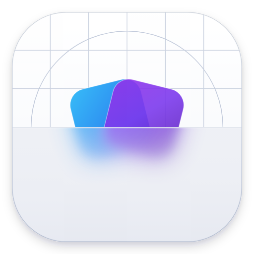
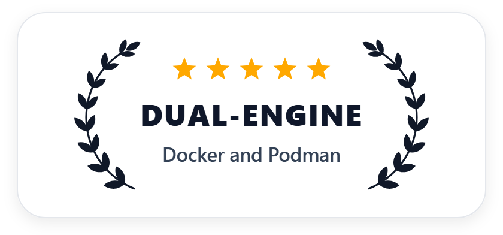
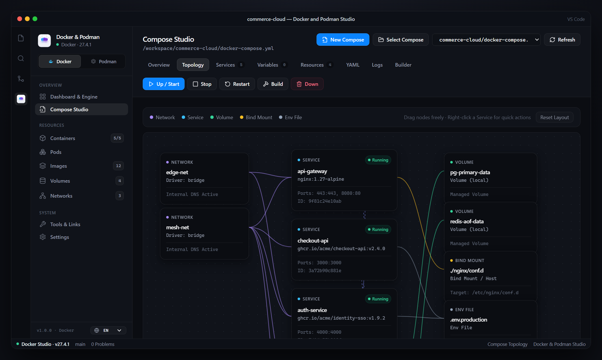
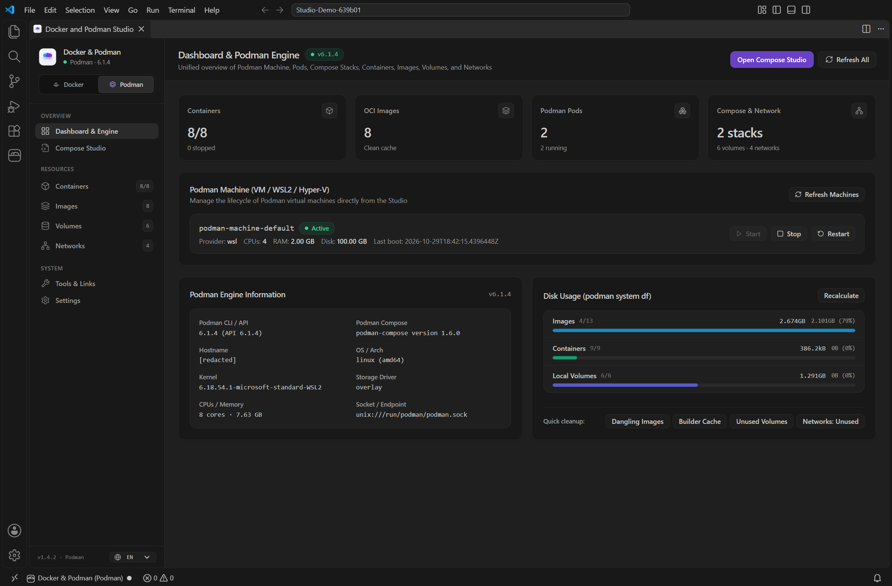
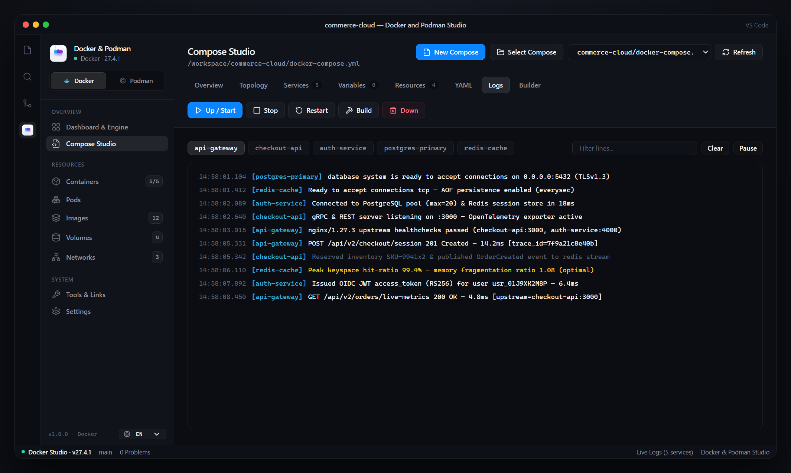
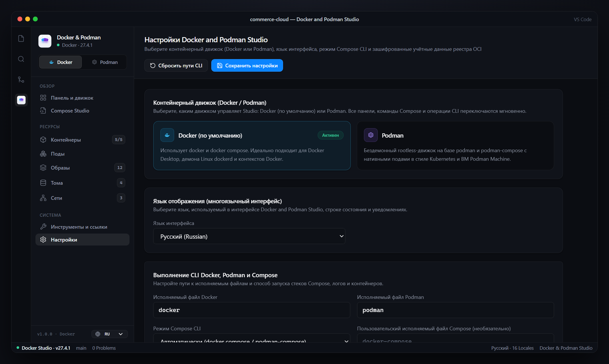

<div align="center">



# Docker and Podman Studio

**The all-in-one visual Studio GUI for Docker & Podman inside Visual Studio Code.**

<p align="center">
  
</p>

[](https://marketplace.visualstudio.com/items?itemName=ItaloAlmeida.docker-and-podman-studio)
[](https://github.com/Italoalmeida0/docker-and-podman-studio-vscode/blob/main/LICENSE)
[](https://code.visualstudio.com/)
[](#dual-engine-architecture-docker--podman)
[](#multi-language-support-16-languages)

Manage **Compose stacks**, **Interactive Architecture Topologies**, **Containers**, **Pods**, **OCI Images**, **Volumes**, **Networks**, **Docker Contexts**, and **Podman Machine VMs** from one sleek Studio panel — powered by **Docker** out of the box, with one-click switching to **Podman**.

[VS Code Marketplace](https://marketplace.visualstudio.com/items?itemName=ItaloAlmeida.docker-and-podman-studio) · [GitHub Releases (.vsix)](https://github.com/Italoalmeida0/docker-and-podman-studio-vscode/releases) · [Report Bug](https://github.com/Italoalmeida0/docker-and-podman-studio-vscode/issues) · [Request Feature](https://github.com/Italoalmeida0/docker-and-podman-studio-vscode/issues)

</div>

---



---

## Why Developers Love Docker and Podman Studio

- **Interactive Drag-and-Drop Compose Topology**: Visualize your entire `docker-compose.yml` or `podman-compose.yml` architecture — **Networks**, **Services**, **Persistent Volumes**, **Bind Mounts**, **Env Files**, and `depends_on` wires — with live health badges and right-click container actions.
- **Dual-Engine Freedom (`Docker` Default + `Podman`)**: Uses **Docker** (`docker` + `docker compose`) out of the box and switches to **Podman** (`podman` + `podman-compose` + native Pods) with a single click in the Sidebar or Settings.
- **Zero Context-Switching**: Stream multi-service logs, open interactive container shells (`exec -it`), switch **Docker Contexts** (Desktop, OrbStack, Colima, Remote SSH), control **Podman Machine** VMs, build `Dockerfile` / `Containerfile` images, and prune disk space without leaving VS Code.
- **Truly Global (`16 Languages`)**: Native localization across 16 languages (`EN`, `PT-BR`, `ES`, `FR`, `DE`, `IT`, `RU`, `UK`, `PL`, `TR`, `NL`, `JA`, `KO`, `ZH-CN`, `ZH-TW`, `HI`) + automatic VS Code language detection (`auto`).

---

## Visual Tour

### 1. Unified Engine Dashboard, Docker Contexts & Storage Analytics
Inspect live daemon telemetry, switch between local and remote **Docker Contexts** (`desktop-linux`, `orbstack`, remote SSH hosts), and analyze reclaimable disk usage (`system df`) at a glance.



### 2. One-Click Podman Mode & Kubernetes-Style Pods
Switch to **Podman** anytime to unlock daemonless rootless container management, **Podman Machine** VM lifecycle controls, and native **Kubernetes-style Pods** with shared network/IPC namespaces. Pods and their member containers appear together in the Containers tree.

### 3. Real-Time Multi-Service Log Streaming
Debug distributed stacks effortlessly with color-coded log levels, per-service filter pills, instant text search, pause/resume controls, or 1-click routing to the VS Code Output Channel and integrated Terminal.



### 4. Instant Engine Selector & 16-Language Localization
Switch between **Docker** and **Podman** or choose from **16 built-in languages** (shown below in Russian — `Русский`) directly inside Studio Settings.



---

## Dual-Engine Architecture: Docker & Podman

**Docker and Podman Studio** uses **Docker** (`"docker"`) by default and lets you switch to **Podman** (`"podman"`) anytime — via **Settings** (`dockerPodmanStudio.engine`), the **Studio Sidebar toggle**, the **Activity Bar** header button, or the **Command Palette** (`Docker and Podman Studio: Switch Container Engine`).

| Capability | Docker Mode *(Default)* | Podman Mode |
| :--- | :--- | :--- |
| **CLI Runtime** | `docker` | `podman` (daemonless / rootless ready) |
| **Compose Runner** | `docker compose` (v2 plugin) & `docker-compose` | `podman-compose` & `podman compose` |
| **Default Scaffold Files** | `docker-compose.yml` + `Dockerfile` | `podman-compose.yml` + `Containerfile` |
| **Host / Context Management** | **Docker Contexts** (`docker context ls` / `use`) | **Podman Machine VMs** (`start` / `stop` / `restart`) |
| **Pod Orchestration** | Standard multi-container Compose networks | Native **Kubernetes-style Pods** + `--in-pod` grouping |
| **Registry Integration** | `docker login` / `logout` + SecretStorage | `podman login` / `logout` + SecretStorage |

---

## Complete Feature Set

### Visual Compose Studio (`docker compose` & `podman-compose`)
- **Interactive Topology Graph**: Drag-and-drop canvas with right-click service context menu (`Start`, `Stop`, `Restart`, `Down`, `Live Logs`).
- **Protected YAML Editing**: Edit common service fields visually or switch to the service's YAML. The editor preserves untouched advanced fields, comments, anchors, extensions, and includes; unsupported field forms remain editable in YAML. Drafts are retained per file and conflicting external edits are shown before saving. Saving is blocked for running services, including containers identified from other profiles; if a Compose container has insufficient identifying labels, Studio conservatively blocks the edit.
- **Visual `New Compose` Wizard**: Create multiple services in one `docker-compose.yml` or `podman-compose.yml`, with a live preview generated from the same configuration that is saved. Configure images or builds, dependencies, healthchecks, ports, environment, volumes, and networks; search Docker Hub, Quay.io, or a private OCI registry. The builder can also add a service to an existing base file.
- **Project Configuration**: Select ordered Compose overrides, active profiles, and an environment file. Studio validates these through the configured provider and uses the same options for status, logs, and commands. Projects with overrides, profiles, an explicit environment file, includes, or extends show provider-resolved configuration; visual edits are disabled for those projects, and the YAML tab edits the base file only.
- **Individual Builds**: Build one or more services without starting containers, rebuild without cache, or explicitly choose **Build & Up**. Build & Up may start dependencies or recreate containers.
- **Replica Logs and Details**: Inspect replica health, exit status, and published ports where available. Follow all replicas or one verified container, pause the display while collecting lines, and filter the history. When timestamped logs are available, reopening the view replays retained lines since the saved history; rotated logs or providers without timestamps may leave gaps. Sensitive environment names are masked by default in selected views, but YAML, logs, and the Compose provider can still expose secrets.
- **Smart Auto-Discovery**: Automatically detects `docker-compose.yml`, `compose.yml`, `podman-compose.yml`, and `container-compose.yml` files in your workspace **and** discovers external Compose projects from active container labels.
- **YAML IntelliSense & Diagnostics**: Real-time autocompletion and schema diagnostics for Compose files directly inside the VS Code editor.
- **Podman Service Scaling**: In the **Services** tab, choose **Scale** and explicitly enter a service's desired replica count, including zero. Scaling above zero runs Compose up and can start dependencies or recreate containers. Scaling down removes excess containers and their writable layers, retains volumes, and asks for confirmation unless deletion confirmations are disabled.
- **Replica-Aware Podman Actions**: Start, stop, restart, and logs include runtime-scaled replicas even when `podman-compose` only expands the counts declared in YAML. Down verifies container removal and safely cleans up leftover replicas, retaining volumes unless explicitly requested and preserving orphan services unless `removeOrphans` is enabled.
- **Selected Services**: Select multiple services to start, stop, restart, build, or remove their containers. Starting or building can also start dependencies or recreate containers. Removing services leaves their Compose definitions and volumes intact, and requires confirmation. Podman removes selected dependents before their dependencies; an unselected dependent is never removed automatically and can block removal.

Studio monitors selected Compose files, the selected and default environment files, and statically identifiable local `include`, `extends.file`, service `env_file` / `label_file`, config, and secret files. Variable-based or external paths cannot always be monitored and trigger a warning; build contexts, other indirect inputs, and changes to process environment variables are not fully tracked. Review those inputs before running commands. File checks reduce conflicts but are not an atomic filesystem transaction. Stop and Down use the saved configuration even when an editor contains an unsaved draft.

### Container, Pod & Infrastructure Management
- **Simple & Advanced Containers**: Launch standalone or Pod-attached containers with port mappings, volume mounts, environment variables, CPU/Memory limits, and custom `--mount` specs. Open an **Interactive Terminal** (`exec -it`) in one click.
- **Container Tree**: The Containers view groups Podman containers under their pods, including empty pods, and groups other Compose containers by project in either engine. Expand a pod to inspect and manage its members; Podman pod creation, lifecycle actions, and logs remain available there.
- **Kubernetes-Style Pods *(Podman Mode)***: Create Pods with custom `--hostname`, published ports, `--network`, `--add-host`, `--cpu-shares`, and labels; inspect member & infra containers; stream Pod logs; and manage Pod lifecycles.
- **Podman Batch Controls**: Select visible containers or pods to start, stop, or restart eligible resources together. Failures are reported per resource. Individual containers and pods can also be paused and resumed; Podman infra containers are protected from individual lifecycle and delete actions.
- **Resource Selection and Cleanup**: Select images or unused volumes and networks for removal. Cleanup identifies candidates explicitly, including named unused volumes, and asks for confirmation with their names; deleting volumes permanently removes their data. Stopped containers count as references. Default networks and Docker non-local networks are protected, and resources are checked again before removal without force.
- **OCI Images, Builds & Prune Suite**: Pull images, build from `Dockerfile` or `Containerfile`, push to remote registries, and reclaim disk space (`Prune Dangling`, `Prune All Unused`, `Clear Builder Cache`).
- **Progress & Errors**: Long-running actions show elapsed time, actual batch counts, and expandable live command output when the engine reports it. Success messages disappear automatically; failures stay visible with a short explanation and expandable technical details. Command Palette actions also show VS Code progress and can open the **Docker and Podman Studio** output channel.
- **Encrypted Registry Authentication**: Store private registry credentials securely in **VS Code `SecretStorage`** (never written in plaintext to `settings.json`) with optional automatic `docker login` / `podman login`.

In Podman mode, image, volume, and network removal does not force-remove resources in use. Podman build-cache cleanup uses `podman image prune --build-cache` when supported; it also removes dangling images. Do not run it during a build.

Builds, image transfers, and other engine-changing commands use a configurable long-operation timeout (60 minutes by default). Short status and registry queries retain separate, shorter timeouts. If a command exceeds its limit, Studio requests that the local command stop, but work may still continue in the engine; refresh and check the actual state before retrying. Remaining batch items are not attempted after a timeout.

The progress view shows a bounded recent output tail; the Studio output channel retains the available full output for the current VS Code session. Build and Compose output can include secrets printed by build scripts or providers, so review logs before sharing them. Registry login and status queries are not streamed as action progress. No estimated finish time is displayed when the engine does not provide one.

---

## Multi-Language Support (16 Languages)

Full internationalization (**i18n**) across the Studio Webview, Status Bar, notifications, Command Palette (`package.nls.*.json`), and Settings descriptions. Follow VS Code's display language automatically (`auto`) or pick your preferred language in **Settings → Interface Language** (`dockerPodmanStudio.language`):

| Code | Language | Code | Language |
| :--- | :--- | :--- | :--- |
| `auto` | Automatic *(VS Code Display Language)* | `pl` | Polski (Polish) |
| `en` | English *(Fallback Default)* | `tr` | Türkçe (Turkish) |
| `pt-BR` | Português (Brasil) | `nl` | Nederlands (Dutch) |
| `es` | Español | `ja` | 日本語 (Japanese) |
| `fr` | Français | `ko` | 한국어 (Korean) |
| `de` | Deutsch | `zh-CN` | 简体中文 (Simplified Chinese) |
| `it` | Italiano | `zh-TW` | 繁體中文 (Traditional Chinese) |
| `ru` | Русский (Russian) | `hi` | हिन्दी (Hindi) |
| `uk` | Українська (Ukrainian) | | |

---

## Requirements

Only the CLI for your selected engine is required:

- **For Docker Mode *(Default)***:
  - **Docker CLI** (`docker`) and **Docker Compose** (`docker compose` v2 plugin or `docker-compose`) — compatible with Docker Desktop, Docker Engine on Linux, OrbStack, Rancher Desktop, and Colima.
- **For Podman Mode**:
  - **Podman CLI** and **Podman Compose** (`podman-compose` or `podman compose`). Provider capabilities vary; the isolated lifecycle and scaling tests have been exercised with Podman 6.1.4 and podman-compose 1.6.0 on Windows.
  - Compose status requires a provider that supports `ps --all -q`, or `podman-compose`, whose `ps -q` includes stopped containers. Studio reports an error instead of silently omitting stopped containers when it cannot establish this.
  - *Windows / macOS*: An initialized Podman Machine (`podman machine init`), manageable directly from the Studio Dashboard.
  - *Windows*: Configure a native executable or a PowerShell script for Podman and Compose. `.cmd` and `.bat` wrappers are rejected for Podman commands because their shell argument handling cannot safely preserve arbitrary input. PowerShell execution policies still apply.

---

## Getting Started

1. Install **Docker and Podman Studio** from the [VS Code Marketplace](https://marketplace.visualstudio.com/items?itemName=ItaloAlmeida.docker-and-podman-studio) (or download the `.vsix` from [GitHub Releases](https://github.com/Italoalmeida0/docker-and-podman-studio-vscode/releases)).
2. Open the Studio from any entry point:
   - Click **`Docker Studio`** / **`Podman Studio`** in the bottom **Status Bar** (shows live connection status).
   - Click the **Docker and Podman Studio** icon in the **Activity Bar**.
   - Open the Command Palette (`Ctrl+Shift+P` / `Cmd+Shift+P`) and run **`Docker and Podman Studio: Open Studio Panel`**.
   - Right-click any `docker-compose.yml`, `compose.yml`, `podman-compose.yml`, `Dockerfile`, or `Containerfile` in the VS Code Explorer.
3. Want to use Podman instead of Docker? Toggle **Docker | Podman** directly in the Studio sidebar or set `"dockerPodmanStudio.engine": "podman"` in VS Code Settings.

---

## Commands

| Command ID | Title |
| :--- | :--- |
| `dockerPodmanStudio.openPanel` | Docker and Podman Studio: Open Studio Panel |
| `dockerPodmanStudio.switchEngine` | Docker and Podman Studio: Switch Container Engine (Docker / Podman) |
| `dockerPodmanStudio.composeUp` | Docker and Podman Studio: Compose Up |
| `dockerPodmanStudio.composeStart` | Docker and Podman Studio: Compose Start |
| `dockerPodmanStudio.composeStop` | Docker and Podman Studio: Compose Stop |
| `dockerPodmanStudio.composeDown` | Docker and Podman Studio: Compose Down |
| `dockerPodmanStudio.composeRestart` | Docker and Podman Studio: Compose Restart |
| `dockerPodmanStudio.composeBuild` | Docker and Podman Studio: Compose Build & Up |
| `dockerPodmanStudio.registerComposeFiles` | Docker and Podman Studio: Register Compose File... |
| `dockerPodmanStudio.createContainer` | Docker and Podman Studio: Create Container |
| `dockerPodmanStudio.createPod` | Docker and Podman Studio: Create Podman Pod |
| `dockerPodmanStudio.createVolume` | Docker and Podman Studio: Create Volume |
| `dockerPodmanStudio.createNetwork` | Docker and Podman Studio: Create Network |
| `dockerPodmanStudio.buildImage` | Docker and Podman Studio: Build Image from Dockerfile / Containerfile |
| `dockerPodmanStudio.pushImage` | Docker and Podman Studio: Push Image to Registry |
| `dockerPodmanStudio.pruneImages` | Docker and Podman Studio: Prune Dangling Images |
| `dockerPodmanStudio.pruneAllImages` | Docker and Podman Studio: Prune All Unused Images |
| `dockerPodmanStudio.pruneBuilderCache` | Docker and Podman Studio: Clear Builder Cache |
| `dockerPodmanStudio.startMachine` | Docker and Podman Studio: Start Podman Machine |
| `dockerPodmanStudio.stopMachine` | Docker and Podman Studio: Stop Podman Machine |
| `dockerPodmanStudio.restartMachine` | Docker and Podman Studio: Restart Podman Machine |
| `dockerPodmanStudio.openToolsMenu` | Docker and Podman Studio: Quick Tools |
| `dockerPodmanStudio.resetEnginePaths` | Docker and Podman Studio: Reset Docker & Podman CLI Paths |

---

## Extension Settings

| Setting | Default | Description |
| :--- | :--- | :--- |
| `dockerPodmanStudio.engine` | `"docker"` | Active container engine (`"docker"` by default, or `"podman"`). |
| `dockerPodmanStudio.language` | `"auto"` | Interface language (`auto`, `en`, `pt-BR`, `es`, `fr`, `de`, `it`, `ru`, `uk`, `pl`, `tr`, `nl`, `ja`, `ko`, `zh-CN`, `zh-TW`, `hi`). |
| `dockerPodmanStudio.dockerPath` | `"docker"` | Path to the `docker` executable. |
| `dockerPodmanStudio.podmanPath` | `"podman"` | Path to the `podman` executable. |
| `dockerPodmanStudio.composeCommandStyle` | `"auto"` | Compose execution mode: `"auto"` (`docker compose` for Docker, `podman-compose` / `podman compose` for Podman), `"plugin"`, `"standalone"`, or `"custom"`. |
| `dockerPodmanStudio.composePath` | `""` | Optional custom Compose binary path (leave empty for automatic engine defaults). |
| `dockerPodmanStudio.inPod` | `"default"` | Pod grouping flag (`--in-pod`) when running `podman-compose` in Podman mode. |
| `dockerPodmanStudio.machineName` | `"podman-machine-default"` | Default Podman Machine VM name (Windows/macOS in Podman mode). |
| `dockerPodmanStudio.pollingInterval` | `2500` | Container status polling interval in milliseconds. |
| `dockerPodmanStudio.logBufferSize` | `5000` | Maximum number of log lines retained in memory. |
| `dockerPodmanStudio.longOperationTimeoutMinutes` | `60` | Timeout for long-running engine actions, in whole minutes from 5 to 720. A timeout does not guarantee that engine-side work has stopped. |
| `dockerPodmanStudio.autoDetectFiles` | `true` | Auto-discover `docker-compose.yml`, `compose.yml`, and `podman-compose.yml` files in workspace and active containers. |
| `dockerPodmanStudio.confirmDeletions` | `true` | Prompt for confirmation before destructive delete or prune operations. |
| `dockerPodmanStudio.logsOutput` | `"studio"` | Default log viewer target (`"studio"`, `"outputChannel"`, or `"terminal"`). |
| `dockerPodmanStudio.enablePushCommand` | `true` | Enable image `Push` actions in the Images page. |
| `dockerPodmanStudio.pushDefaultRegistry` | `""` | Default target registry prefix for image pushes (e.g., `docker.io/my-user` or `quay.io/my-org`). |
| `dockerPodmanStudio.registryProvider` | `"dockerhub"` | Registry provider (`dockerhub`, `quay`, `ghcr`, `acr`, `ecr`, `custom`). |
| `dockerPodmanStudio.registryUrl` | `""` | Custom OCI registry host URL. |
| `dockerPodmanStudio.registryAuthType` | `"engineCli"` | Registry authentication method (`engineCli`, `basic`, `bearer`). |
| `dockerPodmanStudio.registryUsername` | `""` | Username for private OCI registry authentication. |
| `dockerPodmanStudio.registryAutoLogin` | `true` | Run `docker login` / `podman login` automatically when saving credentials. |

---

## Development & Building from Source

```bash
git clone https://github.com/Italoalmeida0/docker-and-podman-studio-vscode.git
cd docker-and-podman-studio-vscode

# Install dependencies
npm install
npm --prefix webview-ui install

# Build Webview UI + Extension Host bundle
npm run build:all

# Run regression tests (no Podman resources are changed)
npm test

# Package into a .vsix installer
npm run package
```

For opt-in tests against an isolated Podman project and resources, see [CONTRIBUTING.md](CONTRIBUTING.md#podman-integration-tests).

---

## License

Released under the [MIT License](LICENSE).  
Copyright © 2026 [Italo Almeida](https://github.com/Italoalmeida0).
